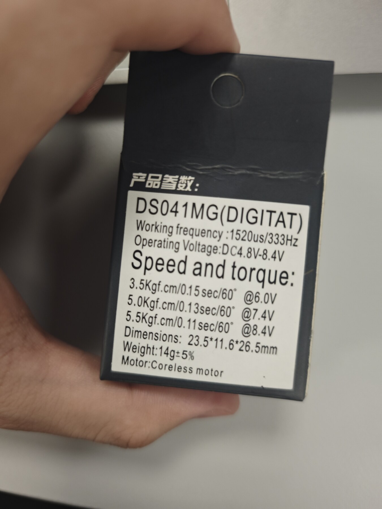

# E-HW-005 — DS041MG 舵机包装铭牌与标称规格

> 证据编号：`E-HW-005-DS041MG舵机包装铭牌与标称规格`
> 认识论角色：`DOC / SPEC`（实物包装铭牌，工程事实标记为 `[SPECIFIED]`）
> 状态：`VALID`
> 规范：包装铭牌只能证明产品包装标称内容，不能替代装机核验、台架测量或负载性能测试。

---

## 1. Scope（工程范围）

- **核心工程问题**：用户提供的 StackForce 腿部舵机外包装标出了什么型号、控制接口、电压、速度、扭矩和外形参数？
- **应用范围**：StackForce 八路腿部舵机的型号候选、仿真初始参数和后续台架验证边界。
- **非目标**：不证明八个装机单元均为同一型号，也不证明装机后的实际速度、堵转扭矩、温升、回差或寿命。

---

## 2. Source Summary（技术源清单）

| Source ID | 类型 | 规范便携路径 | 版本 | 角色与描述 |
|---|---|---|---|---|
| `SRC-HW-012` | `MANUFACTURER_SPEC` | `page/assets/images/E-HW-005-DS041MG舵机包装铭牌与标称规格/ds041mg-package-label.jpg` | 2026-10-13 | 用户提供的舵机实物外包装照片；为便于网页阅读，仅做旋转、缩放与 JPEG 压缩，铭牌内容未改写 |

---

## 3. Evidence Parts（可独立引用的工程事实）

<a id="p01-model-and-electrical-label"></a>
### P01 — 型号、控制标注与工作电压

#### Raw Source Faithful Reproduction（原始证据忠实复刻）



```text
DS041MG(DIGITAT)
Working frequency :1520us/333Hz
Operating Voltage:DC4.8V-8.4V
```

#### Engineering Statement
> [SPECIFIED] 包装铭牌将舵机型号标为 `DS041MG`，并逐字标出 `1520us/333Hz` 与 `DC4.8V-8.4V`；括号内文字在包装上实际印为 `DIGITAT`。

#### Source Observation
- 型号字符串 `DS041MG` 清晰可辨。
- 铭牌把 `1520us` 与 `333Hz` 合并写在 `Working frequency` 字段，没有解释二者分别代表中位脉宽、推荐频率还是允许上限。
- 铭牌电压范围上限为 `8.4V`。

#### Engineering Interpretation
- `DS041MG` 可作为八路腿部舵机的待装机核验型号，并用于检索正式数据手册或建立初始仿真参数。
- 当前固件采用 `50Hz` PWM，铭牌的 `333Hz` 字段不足以单独判定两者兼容或冲突，需通过正式数据手册或台架扫频验证。
- 整机安装手册规定舵机母线设置为 `7.0–7.5V` 且不得超过 `8.0V`；在整机上电时继续采用该更严格的系统级限制，不能按包装上限升至 `8.4V`。

#### Limitations
- 包装照片没有序列号或与八个装机舵机逐一对应的标识，不能证明每个装机单元的型号。
- 铭牌没有给出 PWM 可接受频率范围、脉宽范围、死区、信号电平或反馈接口。
- 包装标称值不是实测值，也不是整机供电安全许可。

#### Source Trace
- 资产：`page/assets/images/E-HW-005-DS041MG舵机包装铭牌与标称规格/ds041mg-package-label.jpg`
- 关键检索符：`DS041MG`, `1520us/333Hz`, `DC4.8V-8.4V`

---

<a id="p02-speed-and-torque-label"></a>
### P02 — 三档电压下的标称速度与扭矩

#### Raw Source Faithful Reproduction（原始证据忠实复刻）

```text
Speed and torque:
3.5Kgf.cm/0.15sec/60° @6.0V
5.0Kgf.cm/0.13sec/60° @7.4V
5.5Kgf.cm/0.11sec/60° @8.4V
```

#### Engineering Statement
> [SPECIFIED] 包装铭牌分别标称：`6.0V` 时 `3.5kgf·cm / 0.15s/60°`，`7.4V` 时 `5.0kgf·cm / 0.13s/60°`，`8.4V` 时 `5.5kgf·cm / 0.11s/60°`。

#### Source Observation
- 铭牌将扭矩和空载转动时间按供电电压成对列出。
- `7.4V` 档落在整机手册规定的 `7.0–7.5V` 母线范围内。

#### Engineering Interpretation
- 在缺少实测辨识前，`7.4V` 档可作为仿真和台架试验的名义初值，不能直接作为可保证的连续输出能力。

#### Limitations
- 铭牌未说明扭矩是堵转、峰值还是连续额定扭矩，也未说明速度测试的负载、温度与容差。
- 不支持从这些标称值推出装机闭链腿的关节带宽或转换准备时间。

#### Source Trace
- 资产：`page/assets/images/E-HW-005-DS041MG舵机包装铭牌与标称规格/ds041mg-package-label.jpg`
- 关键检索符：`Speed and torque`, `@7.4V`

---

<a id="p03-mechanical-label"></a>
### P03 — 外形、重量与电机类型

#### Raw Source Faithful Reproduction（原始证据忠实复刻）

```text
Dimensions: 23.5*11.6*26.5mm
Weight:14g±5%
Motor:Coreless motor
```

#### Engineering Statement
> [SPECIFIED] 包装铭牌标称舵机外形尺寸为 `23.5 × 11.6 × 26.5mm`、重量为 `14g ±5%`，电机类型为 `Coreless motor`。

#### Source Observation
- 铭牌没有注明三个尺寸分别对应长、宽、高的轴向定义。
- 重量带有 `±5%` 容差。

#### Engineering Interpretation
- 尺寸和单机质量可作为 CAD/URDF 初始参数线索；纳入模型前仍需与装机实体和当前几何资产核对。

#### Limitations
- 包装照片不能证明装机后的舵盘、紧固件和线束质量。
- 铭牌未给出减速比、齿轮材质、输出花键规格、轴承配置或转动惯量。

#### Source Trace
- 资产：`page/assets/images/E-HW-005-DS041MG舵机包装铭牌与标称规格/ds041mg-package-label.jpg`
- 关键检索符：`Dimensions`, `Weight`, `Coreless motor`

---

## 4. Provenance & Artifacts（出处与衍生资产）

- **用户提供原图**：`/tmp/codex-clipboard-23f661ec-439c-4b94-b3d1-f729eba086c1.jpg`（会话临时路径，不纳入仓库）
- **Wiki 归档图**：`page/assets/images/E-HW-005-DS041MG舵机包装铭牌与标称规格/ds041mg-package-label.jpg`
- **归档图 SHA256**：`a56fa1140eac37ecd107eccbbc5c105a11677fcf071daf4c55d220115dfae69e`
- **图像处理**：逆时针旋转 90°、最长边缩放至 1800 px、移除元数据并以 JPEG quality 88 保存；铭牌内容未裁切或改写。
